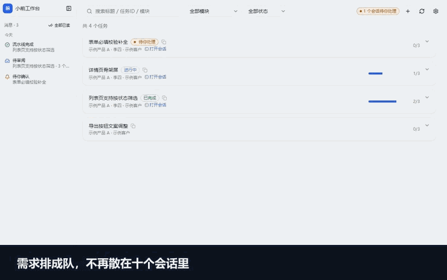
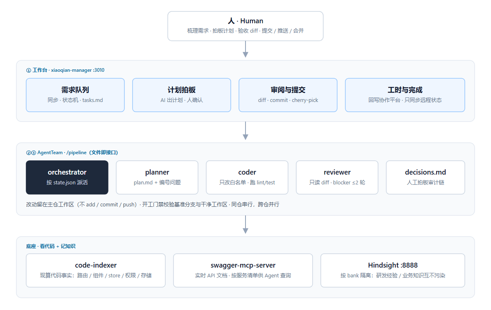

<div align="center">

# febot

**A multi-agent delivery workspace for frontend teams.** Queue requirements, approve the plan, and let planner / coder / reviewer subagents ship code — while humans stay at the gate. Multiple repositories can run in parallel.

[](LICENSE)
[](https://nodejs.org)
[](CONTRIBUTING.md)

[English](README.en.md) · [中文](README.md) · [Roadmap](ROADMAP.md) · [Contributing](CONTRIBUTING.md)

</div>

<!-- The 60s GIF will live at docs/assets/demo-60s.gif. Uncomment once recorded. -->
<!-- <p align="center"></p> -->

> **Status:** early, intentionally narrow. Chinese-first docs (this file is the English entry point). Windows-oriented. Requires [Claude Code](https://claude.com/claude-code) as the runner. Vue 3 repos only.

## Why febot

Most AI coding tools stop at “write this function”. febot covers the whole delivery loop:

|                           | Typical setup                                               | febot                                                                                     |
| ------------------------- | ----------------------------------------------------------- | ----------------------------------------------------------------------------------------- |
| **Requirements don't scatter** | Ten requirements, ten chat threads, nobody knows which repo is being touched | A queue with an explicit state machine and a `tasks.md` ledger; cross-repo parallel, same-repo serial |
| **Humans decide, not type**    | You iterate in chat and only notice the wrong direction at the end | Gates at plan / file allow-list / diff; every decision is written to `decisions.md`        |
| **Separated agent roles**      | One agent writes and reviews its own work                    | planner / coder / reviewer are separate; the reviewer only sees the diff, blockers loop back (max 2 rounds) |

## Quick start

**Prerequisites:** Node ≥ 20.19, yarn 1.22.19, Git. On Windows use Git Bash for the shell scripts.

```bash
git clone https://github.com/Zombiesix/febot.git
cd febot
yarn setup     # generate config templates from example/ and install deps for 4 subprojects
yarn demo      # zero-config demo at http://localhost:3010
yarn dev       # real workspace (reads your febot.config.json)
```

`yarn demo` needs no config and no runner: it seeds `example/demo/` into `.febot/demo-workspace/`
(never your real config or repos) and shows the queue, plan dialog, review queue and a static
session panel. Pipeline start / code submit are disabled with an explicit explanation.
If 3010 is taken it falls back to the next free port (or set `FEBOT_PORT=3050`), and it uses a
separate `.next-demo` build dir so it can run next to your real `yarn dev`.

Measured install on Windows 11 with a warm yarn cache: `yarn setup` ≈ 64 s, `yarn demo` ≈ 5 s to
ready (details in [docs/install-timing.md](docs/install-timing.md); the file is in Chinese).

For real use, launch the workspace, complete the setup wizard (it scans your repo root, registers
repositories/branches and configures the task source), then start the pipeline runner in a second
terminal with `yarn runner`.

## Architecture



- **Workspace** (`xiaoqian-manager`, Next.js): requirement queue, plan approval, review & commit, timesheet write-back.
- **AgentTeam** (`/pipeline` playbook + subagents): orchestrator, planner, coder, reviewer. **The interface is files, not chat history** — handoffs are persisted in `state.json`, `plan.md`, and `decisions.md`.
- **Facts**: `code-indexer` computes frontend code facts on demand (routes, component trees, API domains, stores, permissions, storage); `swagger-mcp-server` feeds live API docs to agents.
- **Memory** (optional): [Hindsight](https://github.com/vectorize-io/hindsight) in Docker (`docker compose up -d` after `yarn setup`), one instance with isolated banks — pipeline expertise vs. product knowledge never mix.

## The 5-step pipeline

```text
① sync           ② plan              ③ code + review + fix     ④ commit          ⑤ timesheet
pull tasks  →  propose plan    →   planner/coder/reviewer   →   human commits  →  write back
from source    human approves        (blockers ≤ 2 rounds)       cherry-pick       to tracker
```

| Step | Who acts | What happens |
| --- | --- | --- |
| ① Sync | Human clicks | Pull requirements from the built-in tracker adapter or a custom script; merge into `tasks.json` (never deletes local tasks). |
| ② Plan | AI drafts, human approves | The planner writes `plan.md` + numbered questions. Nothing is coded before the human signs off in `decisions.md`. |
| ③ Code / review / fix | Agents, automatically | The coder is restricted to `plan.files.json`; the reviewer is read-only and returns blockers/suggestions/nits; blockers go back to the coder (max 2 rounds). |
| ④ Commit | Human | Review the diff in the workspace, then pull → commit → push → cherry-pick → push. |
| ⑤ Timesheet | Human | Write hours back to the tracker. |

### Design choices worth knowing

- **Agents never write to the remote.** They edit the main checkout's working tree and leave changes uncommitted. No `add` / `commit` / `push`.
- **Start gate:** the target repo must be on its configured base branch with a clean working tree. Dirty tree → the pipeline refuses to start.
- **Same-repo serial, cross-repo parallel.** No worktrees: sharing the main checkout means you can start the dev server and verify at any time. A second requirement on the same repo is blocked by the start gate.
- **Full vs. express tier.** Deterministic localization (`scripts/locate.mjs`) can route a small, high-confidence change to a short path that skips planning and review.
- **Optional memory.** Human decisions and corrections can be retained in Hindsight and recalled for the next requirement. If Hindsight is down, the pipeline degrades gracefully.

## The business assistant (optional)

`/assistant` answers questions about your product (“what does this module do?”, “who changes this field?”, “where is the permission checked?”) using the same indexer. It is deliberately read-only toward target repos and only stores knowledge when you explicitly ask it to (`store`), with evidence metadata. Facts are always recomputed; only rationale, terminology, and historical decisions are persisted.

## Repository layout

```text
xiaoqian-manager/     Next.js workspace: queue, plan approval, review, commit, timesheet
desktop/              Optional Electron shell (Windows installer; no UI rewrite)
code-indexer/         Vue 3 static indexer (CLI + MCP), shared by pipeline and assistant
swagger-mcp-server/   Patched swagger-multi MCP server (live API docs)
.claude/              Pipeline playbook, subagents, skills
scripts/              feed / locate / recon / advance state machine, memory CLIs
docs/                 Design docs, requirement templates, assets
example/              Tracked templates copied by `yarn setup` (never edit in place)
```

## Requirements and limitations

| Item | Reality |
| --- | --- |
| Runner | Claude Code only, for now. A runner abstraction is on the roadmap. |
| Frontend stack | Vue 3 indexing is implemented; Vue 2 needs an adapter. |
| OS | Windows-first (Git Bash for scripts). Ubuntu is covered by CI; macOS is not verified yet. |
| Parallelism | Cross-repo only. Same repo is serial by design. |
| Memory layer | Optional. Needs Docker + your own LLM/embedding API keys. |
| Maturity | Early. Expect rough edges; please open an issue with a reproducible case. |

## Contributing

Ideas, bug reports and PRs are welcome. Start with [CONTRIBUTING.md](CONTRIBUTING.md), check [ROADMAP.md](ROADMAP.md) for what we are looking for, and look for issues labeled `good first issue`. By participating you agree to our [Code of Conduct](CODE_OF_CONDUCT.md).

## License

[MIT](LICENSE) © 2026 Zombiesix.

Please report security issues privately as described in [SECURITY.md](SECURITY.md) — do not open a public issue.
